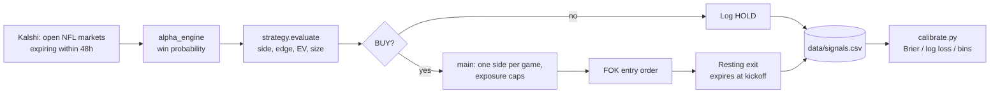

# Kalshi NFL Trading Bot

A Python bot that prices NFL games with its own win-probability model, compares that price to [Kalshi](https://kalshi.com) moneyline markets, and buys only when the model finds a clear edge after the spread and fees.

> [!WARNING]
> This is a learning project. It targets the Kalshi **demo** exchange and runs in **dry-run mode by default** (no orders sent). The model's calibration is unproven. Nothing here is financial advice.

## Contents

- [Features](#features)
- [Requirements](#requirements)
- [Quick Start](#quick-start)
- [Project Structure](#project-structure)
- [How It Works](#how-it-works)
- [Trading Logic](#trading-logic)
- [Configuration](#configuration)
- [Logging and Calibration](#logging-and-calibration)
- [Troubleshooting](#troubleshooting)
- [Status and Limitations](#status-and-limitations)

## Features

- **Own pricing model:** team strength from `nflreadpy` play-by-play data (EPA, success rate, WPA, point margin), adjusted for home field and injuries.
- **Edge filter:** trades only when model probability beats the entry price plus the bid/ask spread, and expected value after fees is positive.
- **Favorite-only:** backs the side the model gives more than 50%, on either YES or NO.
- **Fractional Kelly sizing:** bigger edge gives a bigger position, with per-trade and total exposure caps.
- **Safe by default:** dry run, demo exchange, fill-or-kill entries.
- **Calibration tooling:** every evaluation is logged so the model can be scored against settled results.

## Requirements

- Python **3.11+**
- A Kalshi **demo** account with an API key (key ID and RSA private key `.pem` file)
- Internet access (Kalshi API and `nflreadpy` data downloads)

Python packages are pinned in [requirements.txt](requirements.txt). The main ones are `kalshi-sdk`, `nflreadpy`, `pandas`, `polars` and `python-dotenv`.

## Quick Start

### 1. Get Kalshi demo API credentials

1. Create an account on the Kalshi demo site (`demo.kalshi.co`). It is separate from the production site.
2. In account settings, create an API key.
3. Save the **key ID** and download the **private key** `.pem` file. Kalshi only shows the private key once.
4. Store the `.pem` file outside the repository. `*.pem` is git-ignored anyway, but never commit it.

### 2. Install

```bash
git clone <repo-url>
cd Kalshi-Trading-Bot
python3 -m venv .venv
source .venv/bin/activate
pip install -r requirements.txt
```

### 3. Configure

```bash
cp .env.example .env
```

Edit `.env`:

```dotenv
KALSHI_KEY_ID=your-key-id
KALSHI_PRIVATE_KEY_PATH=/absolute/path/to/kalshi_private_key.pem
DRY_RUN=true
MIN_EDGE=0
```

### 4. Run

```bash
python main.py                          # one dry-run pass: evaluates and logs, sends no orders
LOOP_INTERVAL_SECONDS=900 python main.py  # repeat every 15 minutes
DRY_RUN=false python main.py            # sends real orders to the DEMO exchange
python calibrate.py                     # score logged predictions against settled games
```

Example dry-run output:

```text
2026-10-11 15:00:01 INFO 6 target markets (dry_run=True)
2026-10-11 15:00:09 INFO KXNFLGAME-26OCT12BUFMIA-BUF p=0.712 bid=0.62 ask=0.64 ev=0.0559 -> BUY YES
2026-10-11 15:00:10 INFO KXNFLGAME-26OCT12BUFMIA-MIA p=0.288 bid=0.30 ask=0.40 ev=-0.0027 -> HOLD NO
2026-10-11 15:00:10 INFO DRY RUN: would buy YES KXNFLGAME-26OCT12BUFMIA-BUF x56 @ 0.64 then sell @ 0.71
```

*(Illustrative only; tickers, prices and counts depend on live markets.)*

## Project Structure

| File | Purpose |
|---|---|
| [main.py](main.py) | Entry point. Scores markets, applies portfolio rules, places orders, runs the loop. |
| [alpha_engine.py](alpha_engine.py) | NFL win-probability model, ticker parsing, kickoff lookup. |
| [strategy.py](strategy.py) | Turns a probability and order book into a `Signal`: side, edge, EV, size. |
| [kalshi_client.py](kalshi_client.py) | Kalshi client setup, market discovery, order placement. |
| [trade_log.py](trade_log.py) | Appends evaluations to `data/signals.csv`; reads positions and exposure back. |
| [calibrate.py](calibrate.py) | Scores logged predictions (Brier, log loss, reliability bins). |
| [config.py](config.py) | Loads `.env` and holds risk and sizing constants. |
| `.env.example` | Template for credentials and runtime flags. |
| `data/` | Created at runtime; holds CSV logs. Git-ignored. |

## How It Works



1. **Market discovery** ([kalshi_client.py](kalshi_client.py)): fetches open `KXNFLGAME` markets that expire within 48 hours, sorted by 24h volume. Kickoff time comes from the NFL schedule.
2. **Model** ([alpha_engine.py](alpha_engine.py)): computes the win probability of the ticker's YES team.
   - The ticker is parsed for date and teams. Example: `KXNFLGAME-26SEP13BUFMIA-BUF` is BUF (away) at MIA (home) on 13 Sep 2026, and YES means BUF wins.
   - Each team gets a point-equivalent rating from net EPA, success rate, WPA and margin. Recent games weigh more (half-life 6 games). The last 8 games of the prior season are included, and the rating is shrunk toward 0 when the sample is small.
   - Expected home margin = home rating − away rating + 2.0 points home field.
   - Injury deductions: 4.5 points if the depth-chart starting QB is Out/Doubtful, plus 0.75 points per Out/Doubtful WR, CB, DE or OLB.
   - The margin becomes a probability through a normal CDF (σ = 13.5 points), clamped to [0.01, 0.99].
3. **Signal** ([strategy.py](strategy.py)): picks a side, computes edge and EV, and sizes the position.
4. **Execution** ([main.py](main.py)): ranks candidates, applies risk limits, places orders, and logs every evaluation.

## Trading Logic

### Side selection: favorite-only

Positions are held through kickoff: the exit order expires at kickoff and in practice was rarely filled. The bot therefore only backs the side the model favors.

| Model probability `p` (YES team) | Considered side |
|---|---|
| ≥ 0.5 | **YES** at probability `p` |
| < 0.5 | **NO** at probability `1 − p` |

A side is never bought unless its probability is strictly above 0.5, so `p = 0.5` always holds. This avoids the earlier failure mode of buying "positive-EV" underdogs that still usually lose.

### Edge and expected value

For the chosen side, `entry` is the price paid and `prob` is the model probability of that side:

| Side | `entry` | `prob` | Fills against |
|---|---|---|---|
| YES | YES ask | `p` | best NO bid |
| NO | `1 − YES bid` | `1 − p` | best YES bid |

```text
spread = (ask − bid) + MIN_EDGE
edge   = prob − (entry + spread)
fee    = 0.07 × entry × (1 − entry)
EV     = prob × (1 − entry) − (1 − prob) × entry − fee      (per contract)
```

A signal is **BUY** only when all of these are true:

- `prob > 0.5`
- `edge > 0` and `EV > 0`
- size ≥ 1 contract
- kickoff is known and still in the future
- the exit target (see below) is above `entry`

Otherwise the market is logged as **HOLD**.

### Position sizing: fractional Kelly

```text
stake     = BANKROLL × KELLY_FRACTION × edge / (1 − entry)
stake     = min(stake, MAX_RISK_PER_TRADE)      # skip if below MIN_RISK_PER_TRADE
contracts = floor(stake / entry), limited to the depth at the entry price
```

Edge is already net of spread, so sizing is conservative. Limiting to book depth lets the fill-or-kill order fill completely.

Worked example with default config (YES ask 0.45, YES bid 0.40, so spread = 0.05):

| Model `p` | Edge | Stake | Contracts | Cost |
|---|---|---|---|---|
| 0.55 | 0.05 | $22.73 | 50 | $22.50 |
| 0.70 | 0.20 | $90.91 | 202 | $90.90 |

### Order mechanics

All orders are placed on the YES book:

| Intent | Order sent |
|---|---|
| Buy YES at `x` | YES `bid` at `x`, fill-or-kill |
| Buy NO at `x` | YES `ask` at `1 − x`, fill-or-kill |
| Exit YES at `t` | YES `ask` at `t`, good-till-canceled, expires at kickoff |
| Exit NO at `t` | YES `bid` at `1 − t`, good-till-canceled, expires at kickoff |

The exit target `t` is the side's model probability rounded down to the cent, so it never exceeds fair value. If the exit is not filled by kickoff, the exchange cancels it and the position rides to settlement.

### Portfolio rules ([main.py](main.py))

- **One side per game:** only the best-EV candidate per event; never both teams.
- **No re-entry:** events with a filled live position in the log are skipped.
- **Total exposure cap:** capital deployed (from the log) plus the new trade may not exceed `MAX_TOTAL_EXPOSURE`.
- Candidates are processed in descending EV order, so the best trades use the exposure budget first.

## Configuration

### Environment variables (`.env`)

| Variable | Default | Purpose |
|---|---|---|
| `KALSHI_KEY_ID` | *required* | Demo API key ID |
| `KALSHI_PRIVATE_KEY_PATH` | *required* | Path to the private key `.pem`; must exist |
| `DRY_RUN` | `true` | Orders are sent only when set to exactly `false` |
| `MIN_EDGE` | `0` | Extra safety buffer added to the spread |
| `LOOP_INTERVAL_SECONDS` | `0` | `0` runs one pass; any positive value loops with that sleep |

### Constants in [config.py](config.py)

| Constant | Value | Meaning |
|---|---|---|
| `BANKROLL` | $1,000 | Base for Kelly sizing (fixed; not read from the account) |
| `KELLY_FRACTION` | 0.25 | Quarter Kelly |
| `MAX_RISK_PER_TRADE` | $100 | Per-position cap |
| `MIN_RISK_PER_TRADE` | $5 | Smaller stakes are skipped |
| `MAX_TOTAL_EXPOSURE` | $500 | Cap on cumulative live capital deployed |
| `EXPIRY_WINDOW_HOURS` | 48 | Only markets expiring within this window |
| `KALSHI_BASE_URL` | demo API | Kalshi demo trading API v2 |

Model constants (home field, σ, weights, injury points) are at the top of [alpha_engine.py](alpha_engine.py). All values are initial estimates meant to be tuned once calibration data exists.

## Logging and Calibration

Every evaluation, BUY or HOLD, is appended to `data/signals.csv`:

| Column | Meaning |
|---|---|
| `ts` | UTC timestamp |
| `ticker`, `event` | Market and game |
| `model_prob` | Model probability for the YES team |
| `bid`, `ask` | YES bid and ask |
| `side`, `entry` | Side considered and its entry price |
| `edge`, `ev` | Edge and per-contract EV |
| `action`, `count`, `target` | Decision, contracts, exit price |
| `dry_run` | Whether the run was a dry run |
| `buy_order_id`, `filled`, `sell_order_id` | Live order details |
| `note` | e.g. `FOK not filled`, `SELL FAILED - position unprotected` |

The log is also the bot's memory: the no-re-entry rule and the exposure cap both read live fills from it. **Do not delete `data/signals.csv` while live positions are open.**

If you change the log columns, archive the old file first (for example `data/signals_run1.csv`). [calibrate.py](calibrate.py) reads every `data/signals*.csv`.

### Running calibration

```bash
python calibrate.py
```

For each market, it takes the earliest logged prediction, fetches the settled result from Kalshi, and prints:

- **Brier score** of the model vs. the market ask (lower is better; the model should beat the market before you trust it)
- **Log loss** of the model
- **Reliability table:** predicted vs. actual win rate per 10% probability bin

Run this on a meaningful number of settled games before raising any risk limits.

## Troubleshooting

| Symptom | Cause / fix |
|---|---|
| `RuntimeError: Missing required environment variable` | `.env` is missing or incomplete. Copy `.env.example` and fill in both Kalshi values. Credentials are needed even for dry runs, because the bot reads live order books. |
| `KALSHI_PRIVATE_KEY_PATH does not point to an existing file` | Use an absolute path to the `.pem` file. |
| `0 target markets` | No NFL games expire in the next 48 hours (off-season, or mid-week). |
| Every market is `HOLD` | Normal when there is no edge. Check `edge` and `ev` in `data/signals.csv`. |
| First run is slow | `nflreadpy` downloads play-by-play, schedule, injury and depth-chart data. Later lookups are cached in memory. |
| `FOK not filled` | The book moved between pricing and ordering. The bot does not retry within the same pass. |

## Status and Limitations

- Logic was checked offline against fake order books (side selection, sizing, order construction). It has **not** been validated against live fills.
- NO-side orders assume the demo API treats a YES `ask` as opening a NO position.
- The model is a heuristic, and its calibration is unproven.
- Fees use an approximation of Kalshi's taker fee formula.
- `BANKROLL` is a constant, not the real account balance.
- Exposure is the cumulative cost of live buys in the log. Settled positions are never subtracted, so once `MAX_TOTAL_EXPOSURE` is reached the bot stops trading until the log is archived.
- If the resting exit order fails after a fill, the position stays open without an exit. This is logged as `SELL FAILED - position unprotected`.
- No automated test suite yet.
- Demo environment only. Not financial advice.
