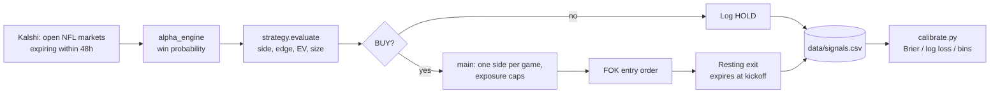

# Kalshi NFL Trading Bot

A bot that compares a quantitative NFL win-probability model against Kalshi moneyline markets, and trades only when the model finds a clear, fee-adjusted edge. It targets the Kalshi **demo** environment and runs in **dry-run mode by default**.

## How It Works



1. **Market discovery** ([kalshi_client.py](kalshi_client.py)): open `KXNFLGAME` markets expiring within 48 hours, sorted by 24h volume. Kickoff time is derived from the game schedule.
2. **Model** ([alpha_engine.py](alpha_engine.py)): win probability for the YES team from `nflreadpy` play-by-play data.
   - Per-team offense/defense EPA, success rate, WPA and point margin, with recency weighting and shrinkage toward a prior-season baseline.
   - Converted to a point spread, with home-field advantage (+2.0) and injury deductions (QB out: 4.5 pts; key skill/defensive positions: 0.75 pts each).
   - Spread mapped to probability through a normal CDF (σ = 13.5), clamped to [0.01, 0.99].
3. **Signal** ([strategy.py](strategy.py)): picks a side, computes edge and EV, and sizes the position.
4. **Execution** ([main.py](main.py)): ranks candidates, applies risk limits, places orders, and logs every evaluation.

## Trading Logic

### Side selection: favorite-only

Positions are held through kickoff (the exit order expires at kickoff and in practice was not filling), so the bot only backs the side the model favors:

| Model probability | Action |
|---|---|
| > 50% | Consider **YES** |
| < 50% | Consider **NO** (the NO side is then the favorite at `1 - p`) |
| = 50% | Hold |

This fixes the earlier failure mode of buying "technically positive-EV" underdogs that still usually lose.

### Edge and EV

For the chosen side, with `entry` as the price paid and `prob` as the model probability for that side:

- **YES:** `entry = ask`, `prob = p`. Fills against the best NO bid.
- **NO:** `entry = 1 - yes_bid`, `prob = 1 - p`. Fills against the best YES bid.

$$\text{spread} = (\text{ask} - \text{bid}) + \text{MIN\_EDGE}$$

$$\text{edge} = \text{prob} - (\text{entry} + \text{spread})$$

$$\text{EV} = \text{prob}\,(1 - \text{entry}) - (1 - \text{prob})\,\text{entry} - \text{fee}, \quad \text{fee} = 0.07 \cdot \text{entry}(1 - \text{entry})$$

A trade is a **BUY** only if all of these hold: `prob > 0.5`, `edge > 0`, `EV > 0`, size ≥ 1 contract, and kickoff is known and in the future.

### Dynamic position sizing (fractional Kelly)

$$\text{stake} = \text{BANKROLL} \times \text{KELLY\_FRACTION} \times \frac{\text{edge}}{1 - \text{entry}}$$

- Larger edge gives a larger position; edge is net of spread, so sizing is conservative.
- Stake is capped at `MAX_RISK_PER_TRADE`; stakes below `MIN_RISK_PER_TRADE` are skipped.
- Contracts are rounded down and limited to the depth at the entry price, so the fill-or-kill order can fill completely.

Example (entry 0.45, YES bid 0.40):

| Model probability | Edge | Contracts | Approx. cost |
|---|---|---|---|
| 0.55 | 0.05 | 50 | $22 |
| 0.70 | 0.20 | 202 | $91 |

### Order mechanics

All orders go through the YES book:

| Intent | Order sent |
|---|---|
| Buy YES at `x` | YES `bid` at `x`, fill-or-kill |
| Buy NO at `x` | YES `ask` at `1 - x`, fill-or-kill |
| Exit YES at `t` | YES `ask` at `t`, good-till-cancelled, expires at kickoff |
| Exit NO at `t` | YES `bid` at `1 - t`, good-till-cancelled, expires at kickoff |

The exit target is the model's side probability rounded down to a tick, and only placed if it exceeds the entry price.

### Portfolio rules (in [main.py](main.py))

- **One side per game:** the best-EV candidate; never both teams.
- **No re-entry:** games with an existing live position are skipped.
- **Total exposure cap:** cumulative deployed capital (from the trade log) may not exceed `MAX_TOTAL_EXPOSURE`.

## Configuration

Set in `.env` (see `.env.example`):

| Variable | Default | Purpose |
|---|---|---|
| `KALSHI_KEY_ID` | required | API key ID |
| `KALSHI_PRIVATE_KEY_PATH` | required | Path to private key PEM |
| `DRY_RUN` | `true` | No orders are sent unless set to `false` |
| `MIN_EDGE` | `0` | Extra buffer added to the spread |
| `LOOP_INTERVAL_SECONDS` | `0` | `0` runs once; otherwise loops |

Tunable constants in [config.py](config.py):

| Constant | Value | Meaning |
|---|---|---|
| `BANKROLL` | $1,000 | Base for sizing |
| `KELLY_FRACTION` | 0.25 | Quarter Kelly |
| `MAX_RISK_PER_TRADE` | $100 | Per-position cap (10%) |
| `MIN_RISK_PER_TRADE` | $5 | Skip smaller stakes |
| `MAX_TOTAL_EXPOSURE` | $500 | Cumulative deployed cap |
| `EXPIRY_WINDOW_HOURS` | 48 | Market selection window |

These sizing values are initial estimates and are meant to be tuned.

## Logging and Calibration

Every evaluation is appended to `data/signals.csv`: ticker, model probability, YES bid/ask, edge, EV, action, count, target, `side`, `entry`, order IDs, fills, and notes. If you have an older log with a different header, archive it (for example to `signals_runN.csv`) before running.

[calibrate.py](calibrate.py) reads all `data/signals*.csv`, fetches settled outcomes, and reports Brier score (model vs. market ask), log loss, and a reliability table by probability bin. Use it to judge whether the model is actually better than the market before raising risk limits.

## Setup and Usage

```bash
python -m venv .venv && source .venv/bin/activate
pip install -r requirements.txt
cp .env.example .env          # fill in credentials
python main.py                # dry run by default
DRY_RUN=false python main.py  # live orders on the demo exchange
python calibrate.py           # score logged predictions
```

## Status and Limitations

- Logic was checked offline against fake order books (side selection, sizing, order construction); it has not been validated against live fills.
- NO-side orders assume the demo API treats a YES `ask` as opening a NO position.
- The model is a heuristic and its calibration is unproven. Run `calibrate.py` on settled games first.
- Fees use an approximation of Kalshi's taker formula.
- Demo environment only; not financial advice.
